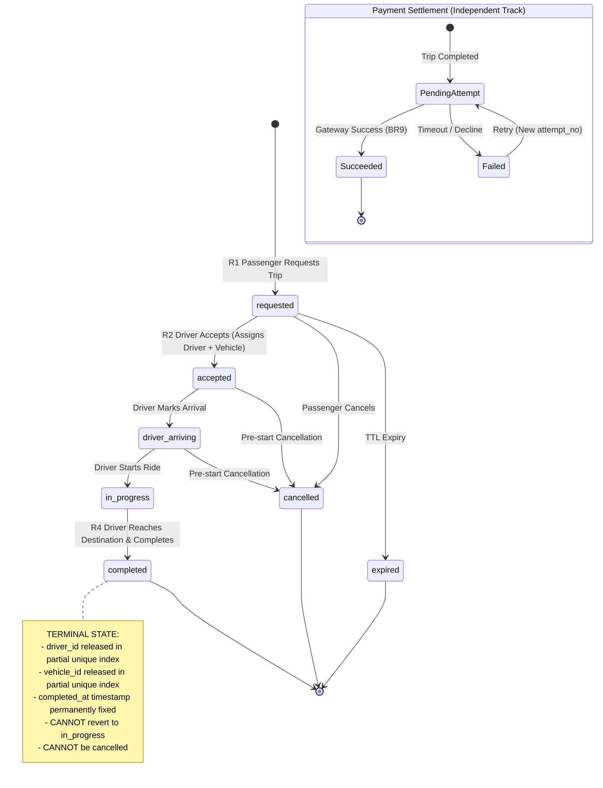

# The Terminal Trap: Why Electronic Payment Failures Must Never Undo Trip Completion

*By the RideFlow Core Engineering Team*

---

When designing domain models for on-demand platforms, the most dangerous architectural flaws rarely stem from complex algorithms or query bottlenecks. Instead, they hide in seemingly innocuous state machine assumptions.

During the design of **RideFlow**—our high-concurrency ride-hailing data platform—we encountered an edge case that appeared deceptively straightforward on paper, but revealed a catastrophic flaw once modeled as a formal finite state machine:

> **What should happen to an active trip when the passenger’s credit card payment fails at destination?**

A common initial instinct in e-commerce workflows is transactional rollbacks: *if payment collection fails, the order is cancelled or reverted to an incomplete state.*

In physical transportation, however, this instinct is a critical trap. Here is the architectural journey of why trip completion must remain strictly decoupled from payment settlement, how our state machine enforces this boundary, and the PostgreSQL implementation that guarantees it.

---

### The Intuitive Flaw: Treating Rides Like Shopping Carts

In typical e-commerce, goods remain in a warehouse until payment authorization succeeds. If the payment gateway times out, the cart remains open, and the inventory lock is released.

In on-demand ride-hailing, physical reality diverges sharply from digital ledgers:

1. **The Physical Service Has Already Been Rendered**: The driver has burned fuel, spent 45 minutes navigating traffic, arrived at the drop-off location, and the passenger has physically stepped out of the vehicle onto the curb. You cannot "rollback" the movement of a motor vehicle through physical space.
2. **The Driver and Vehicle Must Be Liberated**: In our concurrency model, drivers and vehicles are constrained to at most one active trip at any time. This invariant is enforced in PostgreSQL via partial unique indexes:
   ```sql
   -- database/migrations/004_indexes_and_triggers.sql:16-23
   CREATE UNIQUE INDEX trips_active_driver_idx
       ON trips(driver_id)
       WHERE driver_id IS NOT NULL AND status IN ('requested', 'accepted', 'driver_arriving', 'in_progress');

   CREATE UNIQUE INDEX trips_active_vehicle_idx
       ON trips(vehicle_id)
       WHERE vehicle_id IS NOT NULL AND status IN ('requested', 'accepted', 'driver_arriving', 'in_progress');
   ```
   If payment processing fails and the trip were to revert back to `in_progress` or remain stuck in an active state:
   * The driver cannot accept new ride requests (locked out by `trips_active_driver_idx`).
   * The vehicle cannot be assigned to another driver (locked out by `trips_active_vehicle_idx`).
   * The platform effectively penalizes the driver for a banking failure outside their control.

---

### The State Machine Architecture: Dual-Track Lifecycle

To resolve this conflict, RideFlow separates operational state from financial settlement state. A trip’s lifecycle is governed by a strict terminal state machine, while payment attempts are tracked as an independent, append-only retry ledger.



#### The Forbidden Transition
As codified in our state machine specification ([`docs/state-machines.md:51-58`](file:///c:/Users/USER/Desktop/rideflow/docs/state-machines.md#L51-L58)), any backward transition from a terminal state—specifically `completed -> in_progress` or `completed -> cancelled`—is strictly **forbidden**.

If this rule is breached, a malicious actor or a buggy client could repeatedly cycle a trip back and forth, overwriting location telemetry or generating conflicting fare totals.

---

### Enforcing the Invariant in PostgreSQL

To guarantee that application bugs cannot violate this rule, RideFlow enforces the state transition allowlist directly inside PostgreSQL using a PL/pgSQL trigger:

```sql
-- database/migrations/004_indexes_and_triggers.sql:214-239
CREATE OR REPLACE FUNCTION fn_trips_state_machine()
RETURNS TRIGGER AS $$
BEGIN
    IF OLD.status = NEW.status THEN
        RETURN NEW;
    END IF;

    -- Completed is strictly terminal
    IF OLD.status = 'completed' THEN
        RAISE EXCEPTION 'Illegal state transition: trip in terminal status completed cannot be modified to %', NEW.status
            USING ERRCODE = 'check_violation';
    END IF;

    -- Validate allowed progression
    IF OLD.status = 'requested' AND NEW.status NOT IN ('accepted', 'cancelled', 'expired') THEN
        RAISE EXCEPTION 'Illegal state transition from requested to %', NEW.status USING ERRCODE = 'check_violation';
    ELSIF OLD.status = 'accepted' AND NEW.status NOT IN ('driver_arriving', 'cancelled') THEN
        RAISE EXCEPTION 'Illegal state transition from accepted to %', NEW.status USING ERRCODE = 'check_violation';
    ELSIF OLD.status = 'driver_arriving' AND NEW.status NOT IN ('in_progress', 'cancelled') THEN
        RAISE EXCEPTION 'Illegal state transition from driver_arriving to %', NEW.status USING ERRCODE = 'check_violation';
    ELSIF OLD.status = 'in_progress' AND NEW.status <> 'completed' THEN
        RAISE EXCEPTION 'Illegal state transition from in_progress to %', NEW.status USING ERRCODE = 'check_violation';
    END IF;

    RETURN NEW;
END;
$$ LANGUAGE plpgsql;

CREATE TRIGGER trg_trips_state_machine
    BEFORE UPDATE ON trips
    FOR EACH ROW EXECUTE FUNCTION fn_trips_state_machine();
```

---

### Empirical Proof: Test 8 Evidence

During Stage 5B, we verified this exact behavior against an isolated PostgreSQL 16 engine in [`database/tests/test_payment_failure_non_undo.sql`](file:///c:/Users/USER/Desktop/rideflow/database/tests/test_payment_failure_non_undo.sql).

In this scenario:
1. Trip `018d3f62-7b1a-7b3e-8c42-5f69a1e09102` is in status `completed`.
2. An electronic payment gateway transaction times out, recording attempt #2 with status `failed` and `failure_code = 'PROVIDER_TIMEOUT'`.
3. The database transaction verifies the outcome:

**Actual Execution Evidence (`evidence/10_additional_tests.txt:78-115`)**:
```text
EXECUTING: database/tests/test_payment_failure_non_undo.sql
=================================================================
--- TEST 8: Electronic payment failure does NOT undo trip completion (BR14) ---
BEGIN
                  id                  |               trip_id                | attempt_no | status |   failure_code   |          settled_at
--------------------------------------+--------------------------------------+------------+--------+------------------+-------------------------------
 ab7e014f-a252-4484-bba4-93e9012176b1 | 018d3f62-7b1a-7b3e-8c42-5f69a1e09102 |          2 | failed | PROVIDER_TIMEOUT | 2026-10-27 09:33:44.134505+00
(1 row)

INSERT 0 1
                  id                  |  status   |         completed_at
--------------------------------------+-----------+-------------------------------
 018d3f62-7b1a-7b3e-8c42-5f69a1e09102 | completed | 2026-10-27 09:33:42.625349+00
(1 row)

ROLLBACK
```

Notice the architectural invariants demonstrated in the execution log:
1. **The payment failure is faithfully recorded**: Attempt #2 captures the error code (`PROVIDER_TIMEOUT`) and settlement timestamp, preserving an accurate financial audit trail.
2. **The trip remains completed**: Querying the parent trip row immediately after shows `status = 'completed'` and `completed_at` untouched.
3. **The driver is unblocked**: The driver's `trips_active_driver_idx` slot was released at completion, enabling them to receive new dispatch requests while the platform handles asynchronous passenger payment retries in the background.

---

### Key Takeaway for Distributed System Designers

When domain modeling, never mistake **business completion** for **external service settlement**.

By recognizing that a completed physical journey is an immutable operational fact, and by isolating retryable payment attempts onto their own append-only ledger, we eliminate distributed race conditions, keep driver availability responsive, and maintain 100% financial auditability.
