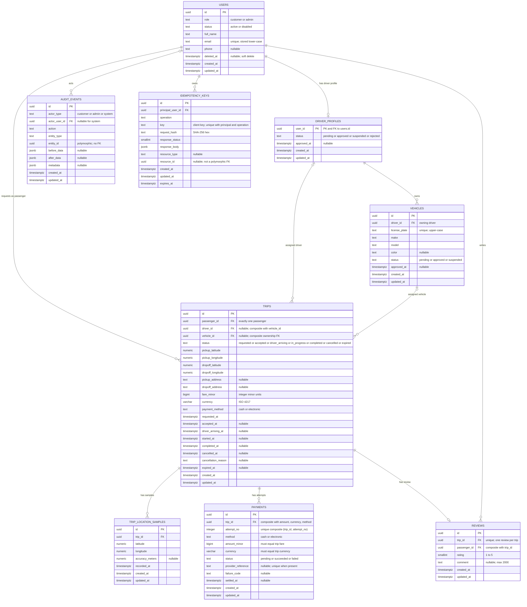

# RideFlow - ER Diagram

| Field | Value |
|---|---|
| Assessment | Task 3 - API Design and Data Modeling |
| Stage | 2 - Entity Model and ER Diagram |
| Status | Draft for approval |
| Baseline | `docs/requirements.md` (approved Stage 1) |
| Companion document | `docs/data-model.md` |
| Scope | Logical ER diagram only; no SQL, migrations, tables or application code |

This diagram is the visual projection of `docs/data-model.md`. The written model remains authoritative for nullability, defaults, checks, partial indexes and trigger behaviour; Mermaid cannot express all of those details. Every entity and field below matches the written model.

## How to read the diagram

- `||` = exactly one; `|o` = zero or one; `o{` = zero or more; `|{` = one or more.
- `PK` = primary key; `FK` = foreign key. Unique and composite constraints are stated in the attribute comments because Mermaid does not model them directly.
- `uuid` identifiers are database-generated with `gen_random_uuid()` in the physical model.
- All timestamps are `timestamptz` and stored in UTC. Every entity has `created_at` and `updated_at`; immutable/append-only entities reject updates, as described in `docs/data-model.md`.
- Money is integer minor units (`bigint`) plus a `varchar(3)` ISO 4217 currency. No floating-point money exists.

## Relationship summary

| Relationship | Cardinality | Key / enforcement |
|---|---|---|
| `users` -> `driver_profiles` | 1 : 0..1 | `driver_profiles.user_id` is PK and FK to `users.id`; a user has at most one driver profile. |
| `users` -> `trips` (passenger) | 1 : 0..* | `trips.passenger_id NOT NULL` FK; every trip has exactly one passenger. |
| `driver_profiles` -> `trips` (driver) | 1 : 0..* | `trips.driver_id` nullable FK; every trip has zero or one driver. |
| `driver_profiles` -> `vehicles` | 1 : 0..* | `vehicles.driver_id NOT NULL` FK; every vehicle has exactly one owning driver. |
| `vehicles` -> `trips` (vehicle) | 1 : 0..* | `trips.vehicle_id` nullable FK; every trip has zero or one vehicle. |
| `trips` -> `trip_location_samples` | 1 : 0..* | `trip_location_samples.trip_id NOT NULL` FK; samples are child telemetry. |
| `trips` -> `payments` | 1 : 0..* | `payments.trip_id NOT NULL` FK; attempts are child financial records. |
| `trips` -> `reviews` | 1 : 0..1 | `reviews.trip_id` is NOT NULL and UNIQUE; one review per trip. |
| `users` -> `reviews` (author/passenger) | 1 : 0..* | `reviews.passenger_id NOT NULL` FK plus composite ownership FK to the trip. |
| `users` -> `audit_events` (actor) | 1 : 0..* | `audit_events.actor_user_id` nullable FK; null only for system actors. |
| `users` -> `idempotency_keys` | 1 : 0..* | `idempotency_keys.principal_user_id NOT NULL` FK. |

## Cross-entity constraints shown by the written model

These are not fully expressible in Mermaid and are therefore repeated here for agreement checking:

1. **Driver/vehicle ownership.** `trips (driver_id, vehicle_id)` references `vehicles (driver_id, id)`. A driver cannot be paired with another driver's vehicle. The two assignment columns are both null or both set.
2. **Same-trip distinctness.** `trips.passenger_id <> trips.driver_id`. Driver profile IDs are user IDs, so this is a direct comparison.
3. **Active-trip uniqueness.** Partial unique indexes enforce one active trip per passenger, per assigned driver and per assigned vehicle. The active statuses are `requested`, `accepted`, `driver_arriving` and `in_progress`.
4. **Review ownership and validity.** `reviews (trip_id, passenger_id)` references `trips (id, passenger_id)`. `reviews.trip_id` is unique. An insert trigger requires the trip to be `completed` and to have a driver. There is deliberately no `reviews.driver_id`; the reviewed driver is `trips.driver_id`.
5. **Fare/payment equality.** `payments (trip_id, amount_minor, currency, method)` references `trips (id, fare_minor, currency, payment_method)`. One successful payment per trip is enforced by a partial unique index.
6. **No duplicate review, no second success.** `reviews.trip_id` and the `payments` successful-attempt partial unique index are the database-level guards.
7. **Polymorphic references.** `audit_events.entity_id` and `idempotency_keys.resource_id` intentionally have no FK; they are documented as non-referential identifiers.
8. **Immutability.** Reviews, audit events and location samples are append-only at the trigger/permission level. Trip fare/currency/payment method and accepted assignment are immutable after the permitted transition. Payment rows may only move from `pending` to a terminal status.

## Diagram/data-model agreement checklist

| Check | Status |
|---|---|
| Every entity in `data-model.md` appears here | Yes: 9 entities. |
| Every field in `data-model.md` appears here | Yes. |
| PK/FK markers agree with the written keys | Yes; composite FKs are described in comments and the constraint list. |
| Nullable driver/vehicle assignment shown | Yes; both are marked nullable and are paired. |
| Driver profile one-to-one | Yes; `user_id` is PK and the relationship is 1 : 0..1. |
| Review target driver not duplicated | Yes; `reviews` has no `driver_id`; the constraint list explains derivation. |
| Payment attempts are child rows | Yes; `trips ||--o{ payments`. |
| Audit actor optional for system | Yes; `actor_user_id` nullable and `users |o--o{ audit_events`. |
| Idempotency principal is required | Yes; `principal_user_id` is non-null FK. |
