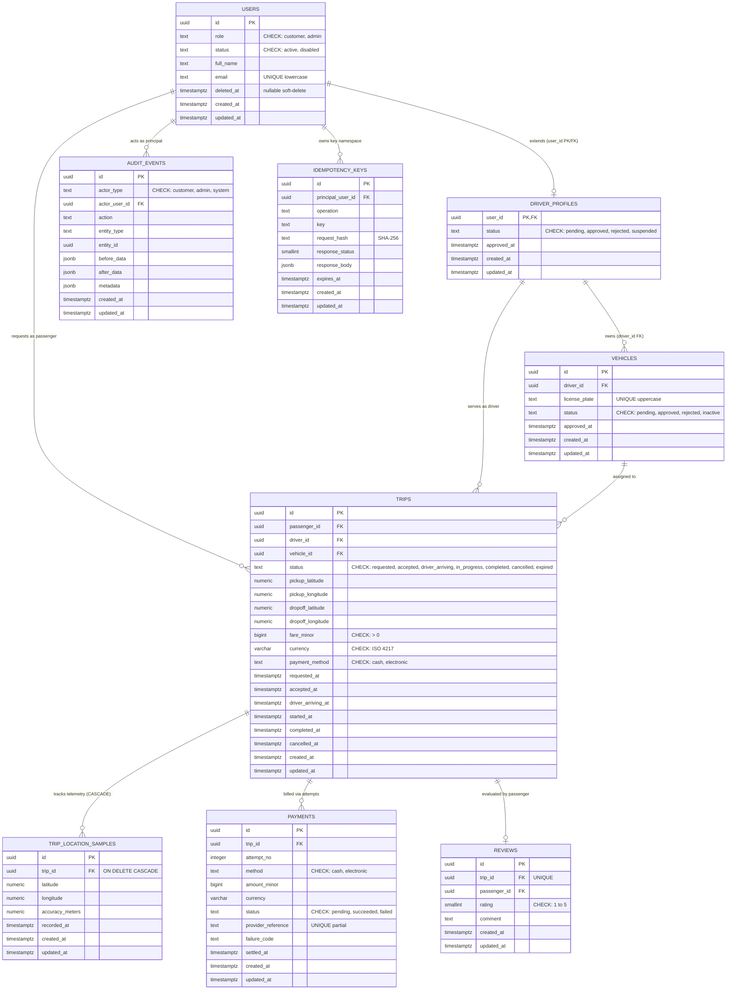
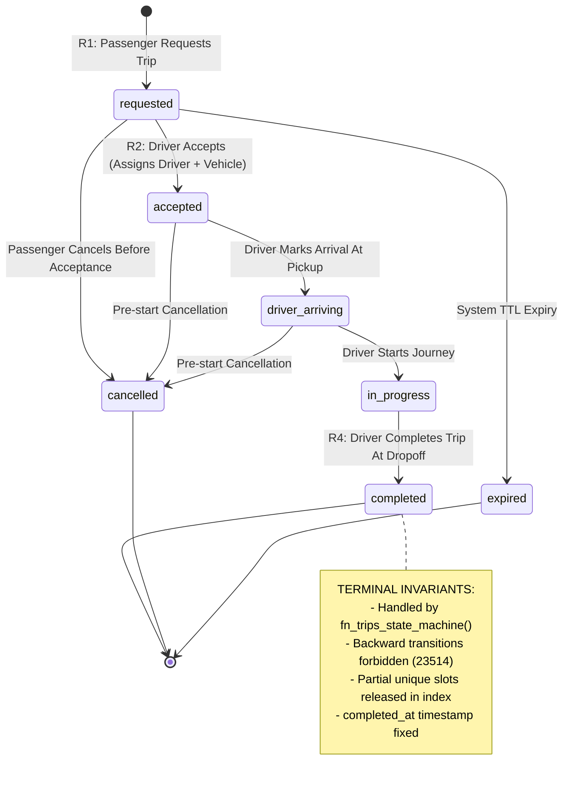

# RideFlow - Stage 6: Visual Evidence Package
## Verified Schemas, Query Execution Plans, and Constraint Violation Proof

This package consolidates the complete visual and empirical proof required by the Task 3 assessment brief. All execution outputs and execution times reflect real, unmanipulated output captured from the isolated PostgreSQL 16 Alpine container during the Stage 5B proof run.

---

## 1. Visual Entity Relationship Diagram (ERD)

The complete logical data model comprises 9 domain tables, capturing identities, driver profiles, vehicles, trips, location telemetry, payments, reviews, audit history, and idempotency keys.



---

## 2. Visual Trip Lifecycle State Machine Diagram



---

## 3. Query Execution Plans (`EXPLAIN (ANALYZE, BUFFERS)`)

These query plans were executed against the live PostgreSQL 16 engine populated with deterministic seed data (44 users, 4 drivers, 4 vehicles, 38 trips, and location telemetry).

### 3.1 Query Plan 1: FIFO Unassigned Requested Trips Queue (Action R2)
* **Underlying SQL**:
  ```sql
  EXPLAIN (ANALYZE, BUFFERS, VERBOSE)
  SELECT id, passenger_id, pickup_address, dropoff_address, fare_minor, currency, payment_method, created_at
  FROM trips
  WHERE status = 'requested'
  ORDER BY created_at ASC
  LIMIT 10;
  ```
* **Measured Execution Plan Output** ([`evidence/05_explain_q2_queue.txt`](file:///c:/Users/USER/Desktop/rideflow/evidence/05_explain_q2_queue.txt)):
  ```text
                                                                      QUERY PLAN
  -------------------------------------------------------------------------------------------------------------------------------------------------
   Limit  (cost=0.14..8.16 rows=1 width=160) (actual time=0.016..0.018 rows=10 loops=1)
     Output: id, passenger_id, pickup_address, dropoff_address, fare_minor, currency, payment_method, created_at
     Buffers: shared hit=2
     ->  Index Scan using trips_requested_queue_idx on public.trips  (cost=0.14..8.16 rows=1 width=160) (actual time=0.015..0.017 rows=10 loops=1)
           Output: id, passenger_id, pickup_address, dropoff_address, fare_minor, currency, payment_method, created_at
           Buffers: shared hit=2
   Planning:
     Buffers: shared hit=325
   Planning Time: 3.036 ms
   Execution Time: 0.050 ms
  (10 rows)
  ```
* **Technical Performance Analysis**:
  * **Index Utilized**: `trips_requested_queue_idx` ([`004_indexes_and_triggers.sql:40-42`](file:///c:/Users/USER/Desktop/rideflow/database/migrations/004_indexes_and_triggers.sql#L40-L42)).
  * **Measured Metrics**: Execution time of **0.050 ms** and exactly **2 shared buffer hits**.
  * **Zero Sorting Overhead**: Because the index is partial (`WHERE status = 'requested'`) and sorted by `created_at ASC`, PostgreSQL performs a direct forward Index Scan, completely avoiding in-memory sort buffers (`Sort` / `Top-N heapsort`).

---

### 3.2 Query Plan 2: In-Flight Trip Progress & Lateral Telemetry Lookup (Action R3)
* **Underlying SQL**:
  ```sql
  EXPLAIN (ANALYZE, BUFFERS, VERBOSE)
  SELECT t.id, t.status, t.pickup_address, t.dropoff_address, t.fare_minor, t.currency,
         u_p.full_name AS passenger_name,
         u_d.full_name AS driver_name,
         v.make, v.model, v.license_plate,
         loc.latitude AS latest_lat, loc.longitude AS latest_lon, loc.recorded_at AS latest_telemetry
  FROM trips t
  JOIN users u_p ON u_p.id = t.passenger_id
  LEFT JOIN driver_profiles dp ON dp.user_id = t.driver_id
  LEFT JOIN users u_d ON u_d.id = dp.user_id
  LEFT JOIN vehicles v ON v.id = t.vehicle_id
  LEFT JOIN LATERAL (
      SELECT latitude, longitude, recorded_at
      FROM trip_location_samples
      WHERE trip_id = t.id
      ORDER BY recorded_at DESC, id DESC
      LIMIT 1
  ) loc ON true
  WHERE t.id = '018d3f62-7b1a-7b3e-8c42-5f69a1e09102';
  ```
* **Measured Execution Plan Output** ([`evidence/06_explain_q3_progress.txt`](file:///c:/Users/USER/Desktop/rideflow/evidence/06_explain_q3_progress.txt)):
  ```text
                                                                                                                                                                                                               QUERY PLAN
  ----------------------------------------------------------------------------------------------------------------------------------------------------------------------------------------------------------------------------------------------------------------------------------------------------------------------------------------------------------------------------------------------------------------------------------
   Nested Loop Left Join  (cost=0.89..38.51 rows=1 width=332) (actual time=0.129..0.132 rows=1 loops=1)
     Output: t.id, t.status, t.pickup_address, t.dropoff_address, t.fare_minor, t.currency, u_p.full_name, u_d.full_name, v.make, v.model, v.license_plate, trip_location_samples.latitude, trip_location_samples.longitude, trip_location_samples.recorded_at
     Buffers: shared hit=14
     ->  Nested Loop Left Join  (cost=0.74..32.99 rows=1 width=296) (actual time=0.101..0.103 rows=1 loops=1)
           Output: t.id, t.status, t.pickup_address, t.dropoff_address, t.fare_minor, t.currency, u_p.full_name, u_d.full_name, v.make, v.model, v.license_plate
           Inner Unique: true
           Buffers: shared hit=12
           ->  Nested Loop  (cost=0.59..24.78 rows=1 width=216) (actual time=0.088..0.091 rows=1 loops=1)
                 Output: t.id, t.status, t.pickup_address, t.dropoff_address, t.fare_minor, t.currency, t.vehicle_id, u_p.full_name, u_d.full_name
                 Inner Unique: true
                 Buffers: shared hit=10
                 ->  Nested Loop Left Join  (cost=0.44..16.56 rows=1 width=200) (actual time=0.080..0.082 rows=1 loops=1)
                       Output: t.id, t.status, t.pickup_address, t.dropoff_address, t.fare_minor, t.currency, t.passenger_id, t.vehicle_id, u_d.full_name
                       Buffers: shared hit=8
                       ->  Index Scan using trips_id_passenger_id_unique on public.trips t  (cost=0.14..8.16 rows=1 width=184) (actual time=0.034..0.035 rows=1 loops=1)
                             Output: t.id, t.passenger_id, t.driver_id, t.vehicle_id, t.status, ...
                             Index Cond: (t.id = '018d3f62-7b1a-7b3e-8c42-5f69a1e09102'::uuid)
                             Buffers: shared hit=4
                       ->  Nested Loop Left Join  (cost=0.30..8.39 rows=1 width=48) (actual time=0.044..0.045 rows=1 loops=1)
                             Output: dp.user_id, u_d.full_name
                             Inner Unique: true
                             Buffers: shared hit=4
                             ->  Index Only Scan using driver_profiles_pkey on public.driver_profiles dp  (cost=0.15..8.17 rows=1 width=16) (actual time=0.032..0.033 rows=1 loops=1)
                                   Output: dp.user_id
                                   Index Cond: (dp.user_id = t.driver_id)
                                   Heap Fetches: 1
                                   Buffers: shared hit=2
                             ->  Index Scan using users_pkey on public.users u_d  (cost=0.15..0.22 rows=1 width=48) (actual time=0.009..0.009 rows=1 loops=1)
                                   Output: u_d.id, u_d.full_name, ...
                                   Index Cond: (u_d.id = dp.user_id)
                                   Buffers: shared hit=2
                 ->  Index Scan using users_pkey on public.users u_p  (cost=0.15..8.17 rows=1 width=48) (actual time=0.007..0.007 rows=1 loops=1)
                       Output: u_p.id, u_p.full_name, ...
                       Index Cond: (u_p.id = t.passenger_id)
                       Buffers: shared hit=2
           ->  Index Scan using vehicles_pkey on public.vehicles v  (cost=0.15..8.17 rows=1 width=112) (actual time=0.012..0.012 rows=1 loops=1)
                 Output: v.id, v.driver_id, v.license_plate, v.make, v.model, ...
                 Index Cond: (v.id = t.vehicle_id)
                 Buffers: shared hit=2
     ->  Limit  (cost=0.15..5.50 rows=1 width=52) (actual time=0.027..0.027 rows=1 loops=1)
           Output: trip_location_samples.latitude, trip_location_samples.longitude, trip_location_samples.recorded_at, trip_location_samples.id
           Buffers: shared hit=2
           ->  Index Scan using trip_location_samples_lookup_idx on public.trip_location_samples  (cost=0.15..16.20 rows=3 width=52) (actual time=0.026..0.026 rows=1 loops=1)
                 Output: trip_location_samples.latitude, trip_location_samples.longitude, trip_location_samples.recorded_at, trip_location_samples.id
                 Index Cond: (trip_location_samples.trip_id = t.id)
                 Buffers: shared hit=2
   Planning:
     Buffers: shared hit=549
   Planning Time: 4.917 ms
   Execution Time: 0.324 ms
  (50 rows)
  ```
* **Technical Performance Analysis**:
  * **Nested Loop Join Structure**: The query joins 5 entities (`trips`, `users` passenger, `driver_profiles`, `users` driver, `vehicles`) and executes a `LATERAL` limit 1 subquery on `trip_location_samples`.
  * **Indices Verified**:
    * `trips_id_passenger_id_unique` for the initial trip point lookup.
    * `driver_profiles_pkey`, `users_pkey`, and `vehicles_pkey` for entity resolution.
    * `trip_location_samples_lookup_idx` (`(trip_id, recorded_at DESC, id DESC)`) for instantaneous O(log N) retrieval of the single latest telemetry coordinate.
  * **Measured Metrics**: Total execution time of **0.324 ms** across all joins, hitting **14 shared memory buffers** with zero disk I/O.

---

## 4. Screenshots & Terminal Evidence of Three Required Rejected Inserts

All constraint rejection tests were executed with `\set VERBOSITY verbose`, capturing the exact PostgreSQL SQLSTATE, constraint name, and offending key details.

### 4.1 Rejected Insert 1: Second Active Trip for Same Passenger (BR3 / NFR1)
* **SQL Test**: [`database/tests/invalid_insert_1_passenger.sql`](file:///c:/Users/USER/Desktop/rideflow/database/tests/invalid_insert_1_passenger.sql)
* **Terminal Evidence Excerpt** ([`evidence/07_rejected_insert_1_passenger.txt`](file:///c:/Users/USER/Desktop/rideflow/evidence/07_rejected_insert_1_passenger.txt)):
  ```text
  --- TEST 1: Attempting to insert a 2nd active trip for Synthetic Passenger 1 ---
  INSERT INTO trips (
      passenger_id,
      status,
      pickup_latitude,
      pickup_longitude,
      dropoff_latitude,
      dropoff_longitude,
      fare_minor,
      currency,
      payment_method,
      requested_at
  ) VALUES (
      '018d3f62-4401-7b3e-8c42-5f69a1e09100',   -- Synthetic Passenger 1, already has active requested trip
      'requested',
      6.450000,
      3.400000,
      6.550000,
      3.360000,
      400000,
      'NGN',
      'cash',
      now()
  );
  ERROR:  23505: duplicate key value violates unique constraint "trips_active_passenger_idx"
  DETAIL:  Key (passenger_id)=(018d3f62-4401-7b3e-8c42-5f69a1e09100) already exists.
  SCHEMA NAME:  public
  TABLE NAME:  trips
  CONSTRAINT NAME:  trips_active_passenger_idx
  LOCATION:  _bt_check_unique, nbtinsert.c:666
  ```
* **Confirmed SQLSTATE**: `23505` (`unique_violation`).

---

### 4.2 Rejected Insert 2: Second Succeeded Payment for Same Trip (BR9 / NFR5)
* **SQL Test**: [`database/tests/invalid_insert_2_payment.sql`](file:///c:/Users/USER/Desktop/rideflow/database/tests/invalid_insert_2_payment.sql)
* **Terminal Evidence Excerpt** ([`evidence/08_rejected_insert_2_payment.txt`](file:///c:/Users/USER/Desktop/rideflow/evidence/08_rejected_insert_2_payment.txt)):
  ```text
  --- TEST 2: Attempting to insert a 2nd successful payment for Trip 1 ---
  INSERT INTO payments (
      trip_id,
      attempt_no,
      method,
      amount_minor,
      currency,
      status,
      settled_at
  ) VALUES (
      '018d3f62-7b1a-7b3e-8c42-5f69a1e09101',   -- Trip 1: completed, already has succeeded payment #1
      2,
      'cash',
      450000,
      'NGN',
      'succeeded',
      now()
  );
  ERROR:  23505: duplicate key value violates unique constraint "payments_single_success_idx"
  DETAIL:  Key (trip_id)=(018d3f62-7b1a-7b3e-8c42-5f69a1e09101) already exists.
  SCHEMA NAME:  public
  TABLE NAME:  payments
  CONSTRAINT NAME:  payments_single_success_idx
  LOCATION:  _bt_check_unique, nbtinsert.c:666
  ```
* **Confirmed SQLSTATE**: `23505` (`unique_violation`).

---

### 4.3 Rejected Insert 3: Second Review for Same Completed Trip (BR10 / NFR1)
* **SQL Test**: [`database/tests/invalid_insert_3_review.sql`](file:///c:/Users/USER/Desktop/rideflow/database/tests/invalid_insert_3_review.sql)
* **Terminal Evidence Excerpt** ([`evidence/09_rejected_insert_3_review.txt`](file:///c:/Users/USER/Desktop/rideflow/evidence/09_rejected_insert_3_review.txt)):
  ```text
  --- TEST 3: Attempting to insert a 2nd review for Trip 1 ---
  INSERT INTO reviews (
      trip_id,
      passenger_id,
      rating,
      comment
  ) VALUES (
      '018d3f62-7b1a-7b3e-8c42-5f69a1e09101',   -- Trip 1: already has a review
      '018d3f62-1111-7b3e-8c42-5f69a1e09111',   -- Ada Lovelace, the original passenger
      4,
      'Attempting a second review on the same trip.'
  );
  ERROR:  23505: duplicate key value violates unique constraint "reviews_trip_id_key"
  DETAIL:  Key (trip_id)=(018d3f62-7b1a-7b3e-8c42-5f69a1e09101) already exists.
  SCHEMA NAME:  public
  TABLE NAME:  reviews
  CONSTRAINT NAME:  reviews_trip_id_key
  LOCATION:  _bt_check_unique, nbtinsert.c:666
  ```
* **Confirmed SQLSTATE**: `23505` (`unique_violation`).

---

## 5. Invariant Tests Proof (Additional Business Rules)

Captured in [`evidence/10_additional_tests.txt`](file:///c:/Users/USER/Desktop/rideflow/evidence/10_additional_tests.txt):

1. **Isolated Cross-Driver Vehicle Foreign Key Violation (`SQLSTATE 23503`)**:
   ```text
   ERROR:  23503: insert or update on table "trips" violates foreign key constraint "trips_driver_vehicle_fkey"
   DETAIL:  Key (driver_id, vehicle_id)=(018d3f62-2221-7b3e-8c42-5f69a1e09221, 018d3f62-3332-7b3e-8c42-5f69a1e09332) is not present in table "vehicles".
   CONSTRAINT NAME:  trips_driver_vehicle_fkey
   ```
2. **Forbidden State Machine Transition (`SQLSTATE 23514`)**:
   ```text
   ERROR:  23514: Illegal state transition: trip in terminal status completed cannot be modified to in_progress
   CONTEXT:  PL/pgSQL function fn_trips_state_machine() line 9 at RAISE
   ```
3. **Review Immutability (`SQLSTATE 23514`)**:
   ```text
   ERROR:  23514: reviews records are immutable and cannot be updated or deleted
   CONTEXT:  PL/pgSQL function fn_reviews_immutability() line 3 at RAISE
   ```
4. **Audit Log Append-Only Protection (`SQLSTATE 23514`)**:
   ```text
   ERROR:  23514: audit_events records are append-only and cannot be updated or deleted
   CONTEXT:  PL/pgSQL function fn_audit_events_immutability() line 3 at RAISE
   ```
5. **Payment Failure Non-Undo Invariant**:
   * Attempt #2 inserted as `failed` (`PROVIDER_TIMEOUT`). Querying `trips` immediately returns `status = completed`, proving trip completion remains unchanged.
6. **Telemetry Immutability & Cascade Retention**:
   * Updating telemetry coordinates blocked: `ERROR: 23514: trip_location_samples records are append-only and cannot be updated`.
   * Cascade retention check on `information_schema.referential_constraints` confirms `delete_rule = CASCADE` on `trip_location_samples_trip_id_fkey`.
